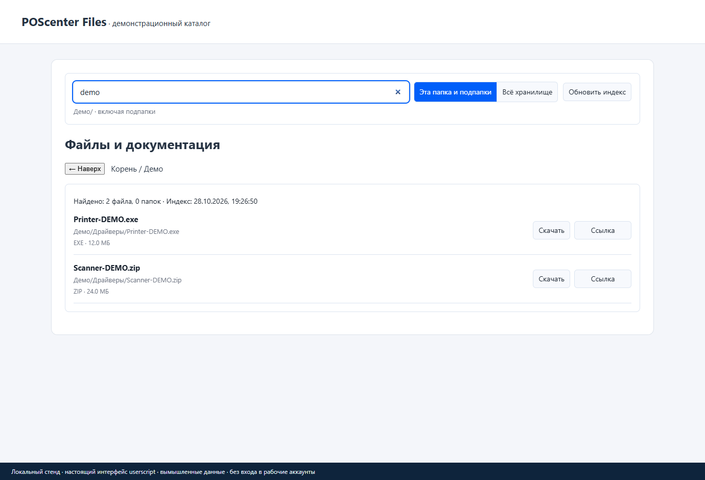

# POScenter Files — поиск и загрузка без лишних кликов

**Tampermonkey · 1.1.1 · Jeronimo701**

Ищет файлы не только в открытой папке, но и во вложенных разделах [fs.poscenter.org](https://fs.poscenter.org). Помогает скачать папку целиком, посмотреть документ и быстро скопировать ссылку.

[Установить скрипт](https://raw.githubusercontent.com/jeronimo701/Poscenter-file-catalog-plus/main/Poscenter_file_catalog_plus.user.js) · [Изменения](CHANGELOG.md) · [Сообщить о проблеме](https://github.com/jeronimo701/Poscenter-file-catalog-plus/issues)

*Настоящий интерфейс скрипта на локальной тестовой странице, с вымышленными данными. Это не снимок рабочего аккаунта или реального каталога сайта.* [Папки и действия](docs/screenshots/folders.png)

## Что умеет

- Поиск по имени файла, папки или части пути: в текущем разделе либо во всём хранилище.
- Загрузка содержимого папки с прогрессом и возможностью остановки.
- Предпросмотр поддерживаемых документов и медиа, ссылки на файлы и папки.
- Разные значки для типов файлов, сохранение поискового индекса в браузере.

## Установка и первый запуск

1. Установи [Tampermonkey](https://www.tampermonkey.net/) в поддерживаемый браузер.
2. Нажми **«Установить скрипт»** выше и подтверди установку в расширении.
3. Открой [fs.poscenter.org](https://fs.poscenter.org) и обнови вкладку после установки.
4. Введи название или часть пути. Выбери «Эта папка и подпапки» либо «Всё хранилище».
5. У папки используй кнопку загрузки; у результата — просмотр, скачивание или копирование ссылки.

Не включай одновременно несколько старых копий этого скрипта.

## Обновления

Автообновление настроено: `@updateURL` ведёт на небольшой `.meta.js`, `@downloadURL` — на актуальный `.user.js` в этом публичном репозитории. GitHub-вход и токен не нужны.

**Если раньше стояла копия с `@updateURL none`, её нужно один раз переустановить по ссылке выше.** Такая копия сама не узнает новый адрес. `@name` и `@namespace` сохранены; перед переустановкой сделай резервную копию настроек средствами Tampermonkey. Дальше проверь, что автоматическая проверка обновлений включена в расширении; мгновенное уведомление не гарантируется.

[Как устроены updateURL и downloadURL](https://www.tampermonkey.net/documentation.php#meta:updateURL).

## Что важно знать

Первое построение индекса может занять время. Для серии загрузок браузер может запросить разрешение. Ссылки и доступность файлов зависят от самого хранилища; скрипт не предоставляет дополнительных прав доступа.

## Проверка и разработка

Проверены синтаксис JavaScript, согласованность метаданных и работа интерфейса на локальном стенде. Поиск на стенде использует тестовый XML-ответ. Массовая загрузка с настоящего сервера и обновление в установленном Tampermonkey не проверялись.

После изменения кода повысь `@version`, выполни `python tools/sync_meta.py` и `python -m unittest discover -s tests -v`, затем отправь `.user.js` и `.meta.js` вместе. Проверка синтаксиса: `node --check Poscenter_file_catalog_plus.user.js`.

## Условия использования

Самостоятельная доработка, не официальный продукт владельца сайта. Условия собственного кода: [LICENSE.txt](LICENSE.txt), область — [LICENSE-SCOPE.md](LICENSE-SCOPE.md). Разрешено бесплатное личное некоммерческое использование физическими лицами; использование организациями и продажа требуют отдельного разрешения. Это source-available, не MIT/GPL.

История переноса сохранена в Git и [историческом README](README-GIST-HISTORICAL.md); прежние ссылки Gist не являются установочными.
